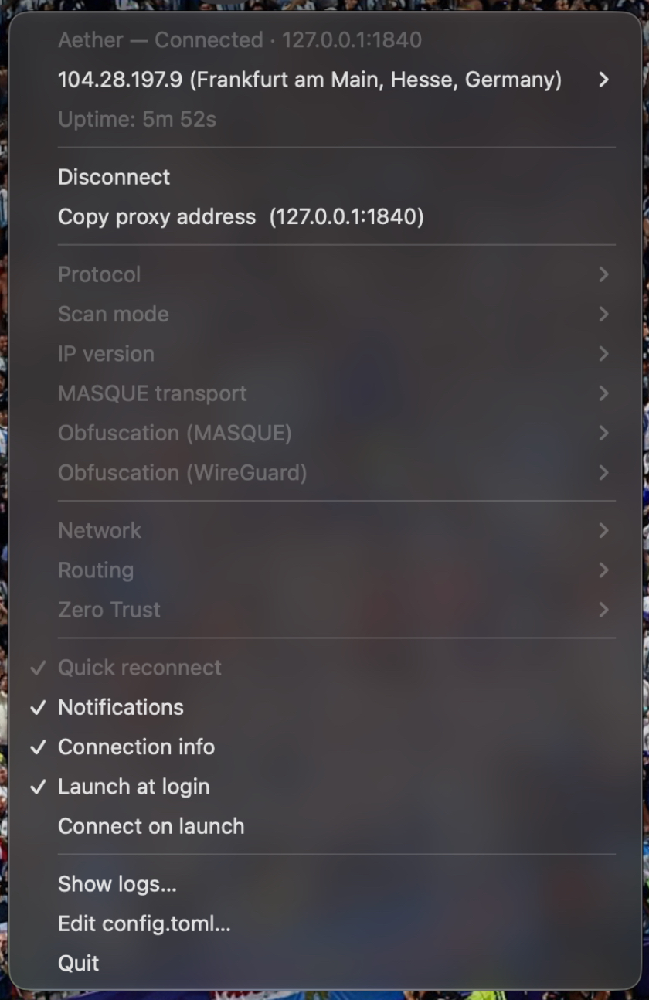

<table>
<tr>
<td>

# Aether Tray

**A native system tray client for [Aether](https://github.com/CluvexStudio/Aether) — Cloudflare WARP, built for censorship circumvention.**


[](https://github.com/rendinjast/aether-tray/actions/workflows/release.yml)

</td>
<td align="center">



</td>
</tr>
</table>

---

Aether is a Cloudflare WARP censorship-circumvention tool. Aether Tray runs its
core as a background process and provides a native system tray application to
control it — connect, disconnect, monitor the tunnel, and inspect what the
connection looks like from the outside. The application has no window by
design: everything lives in the tray, with native OS dialogs for the handful of
settings that require free-text input.

The core exposes a local SOCKS5 proxy (default `127.0.0.1:1819`); point
applications at it and they travel through the tunnel. Nothing touches the
system network stack — no TUN device, no routing-table changes, no DNS
reconfiguration, no system proxy, and no privilege elevation anywhere.

```sh
curl --socks5 127.0.0.1:1819 https://cloudflare.com/cdn-cgi/trace
```

---

## Features

| Feature                             | Description                                                                                                                                            |
| ----------------------------------- | ------------------------------------------------------------------------------------------------------------------------------------------------------ |
| One-click connect                   | Launches the Aether core with your saved profile, monitors it, and auto-reconnects with backoff if the tunnel drops.                                   |
| Connection info                     | Shows the tunnel's exit IP, location, and ISP (resolved through the tunnel via ifconfig.co) directly in the tray menu, with one-click copy.            |
| Live uptime                         | The menu displays how long the current tunnel has been up, updated in real time.                                                                       |
| Full profile control                | Protocol (Auto / MASQUE / WireGuard / gool), scan mode, IP version, obfuscation profiles, quick reconnect, and MASQUE over HTTP/2 — all from the menu. |
| Cloudflare Zero Trust               | Organization teams, email / service-token / access-token sign-in, and Gateway routing. Credentials are never written to disk.                          |
| Routing lists                       | Block and direct domain/CIDR lists, plus an Aether routing rules file, all editable from the tray.                                                     |
| Smart notifications                 | Notifications only for the transitions that matter: connected, connection lost (retrying), and errors.                                                 |
| Launch at login / connect on launch | Optional autostart, with a real "connect on launch" setting.                                                                                           |
| Headless mode                       | `--no-tray` runs the supervisor on servers and desktops without a tray, logging to stdout.                                                             |
| CLI remote control                  | `connect` / `disconnect` / `status` subcommands talk to a running tray over a local socket.                                                            |
| Lightweight                         | No Electron, no embedded runtime — a native Rust binary.                                                                                               |

---

## Installation

Download the installer for your platform from the
[Releases](https://github.com/rendinjast/aether-tray/releases) page:

| Platform              | Artifact                           |
| --------------------- | ---------------------------------- |
| macOS (Apple Silicon) | `Aether-macos-arm64.dmg` / `.zip`  |
| macOS (Intel)         | `Aether-macos-x86_64.dmg` / `.zip` |
| Linux x86_64          | `Aether-linux-x86_64.AppImage`     |
| Linux aarch64         | `Aether-linux-aarch64.AppImage`    |
| Windows x86_64        | `Aether-windows-x86_64.zip`        |

> **Note:** The macOS bundles are ad-hoc signed only — on first launch,
> right-click → Open. Linux requires a StatusNotifierItem host (see
> [Platform notes](#platform-notes)).

### Building from source

Requires a stable Rust toolchain and the platform's GTK/tray dependencies
(see [Development](#development)):

```sh
./binaries/fetch-aether.sh      # downloads the Aether core binary
cargo build --release
```

The `aether` core is a separate executable and is looked up in this order:
next to this executable → `core_path` in `config.toml` → `$PATH`.

---

## Usage

```
aether-tray                    launch the tray (default)
aether-tray --no-tray          headless supervisor, logs to stdout
aether-tray connect [--protocol masque --scan-mode turbo --ip-version both --bind 0.0.0.0:1819]
aether-tray disconnect
aether-tray status [--json]
```

The subcommands talk to a running tray over a local socket. If nothing is
listening, `connect` starts a headless supervisor in-process rather than
failing.

```sh
# Machine-readable status — handy for scripts, bars, and dashboards:
$ aether-tray status --json
{
  "state": "connected",
  "socks_addr": "127.0.0.1:1819",
  "connected_at_ms": 1723000000000,
  "geo": {
    "ip": "104.28.246.164",
    "country": "Iran",
    "city": "Tehran",
    "asn": "AS13335",
    "asn_org": "CLOUDFLARENET"
  }
}
```

---

## Connection info

While connected, the tray resolves what the tunnel actually looks like from
the outside by asking [`ifconfig.co`](https://ifconfig.co) through the SOCKS5
proxy (`socks5://`, so the proxy resolves DNS inside the tunnel too): exit IP,
city/region/country, and ISP/ASN. It appears as a tray submenu titled with
your IP and location:

```
Aether — Connected · 127.0.0.1:1819
  > 104.28.246.164 (Tehran, Iran)      <- IP + location
      Copy IP
      Refresh
  Uptime: 3m 12s
  ...
```

The lookup is fire-and-forget — a failure never disturbs the connection (the
menu shows `IP: unavailable`, and **Refresh** re-runs the lookup without
reconnecting). Because it is an extra request to a third party, it is a
setting: uncheck **Connection info** in the tray menu (or set
`show_connection_info = false` in `config.toml`) to stop the lookup entirely.

---

## Configuration

Settings live in `config.toml` inside the platform config directory:

| Platform | Path                                         |
| -------- | -------------------------------------------- |
| macOS    | `~/Library/Application Support/aether-tray/` |
| Windows  | `%APPDATA%\aether-tray\`                     |
| Linux    | `~/.config/aether-tray/`                     |

Most settings are edited from the tray menu. App-level settings:

| Setting                | Default | Description                                      |
| ---------------------- | ------- | ------------------------------------------------ |
| `notifications`        | `true`  | Desktop notifications for connect / lost / error |
| `show_connection_info` | `true`  | Resolve and display tunnel IP/location/ISP       |
| `launch_at_login`      | `false` | Start the tray at login                          |
| `connect_on_launch`    | `false` | Auto-connect once the tray is up                 |
| `core_path`            | —       | Optional explicit path to the core binary        |

**How your data is handled:**

- The profile is persisted only on reaching `Connected`, never on a mere
  attempt — a bad guess cannot poison future one-click connects.
- All four Cloudflare Access credentials are scrubbed before writing. They
  stay in process memory for the session and are asked for again next launch.
  Nothing sensitive ever touches disk.
- On first run, settings are migrated from the windowed Aether-GUI app
  (`com.cluvexstudio.aethergui`); the originals are left untouched, so the old
  app keeps working. The core's working directory deliberately stays pointed
  at the old data directory when it exists — the core writes its provisioned
  WARP identity (`aether-masque.toml` / `aether.toml`) there, and moving it
  would silently re-provision every existing user's identity.

---

## Platform notes

- **Linux tray requires a StatusNotifierItem host.** This is a real
  limitation, not a footnote: on stock GNOME there is no tray at all — install
  an AppIndicator extension (e.g.
  [AppIndicator and KStatusNotifierItem Support](https://extensions.gnome.org/extension/615/appindicator-support/)).
  Without one the icon silently does not appear; run `--no-tray` instead. GTK3
  and libayatana-appindicator are required at build and run time.
- **Wayland** gives no cursor position, so menu placement is
  compositor-controlled.
- **Linux dialogs** require `zenity` or `kdialog`. With neither installed, the
  free-text menu items are greyed out and "Edit config.toml…" is the way in;
  everything expressible as a radio group or checkbox still works from the
  menu.

---

## Development

```sh
cargo test
cargo fmt --check && cargo clippy --all-targets -- -D warnings
```

---

## Packaging & releases

```sh
./packaging/macos-app.sh              # dist/Aether.app
./packaging/macos-dmg.sh <app> <dmg>  # drag-and-drop DMG from an existing bundle
./packaging/linux-appimage.sh         # dist/Aether-<version>-x86_64.AppImage
pwsh -File packaging/windows-zip.ps1  # dist/Aether-<version>-x86_64-windows.zip
```

Each script bundles the fetched core next to the executable, where the binary
looks first. The `Release` workflow builds the full platform matrix (macOS
arm64/x86_64, Linux x86_64/aarch64, Windows x86_64) and opens a release —
either from a `v*` tag or automatically from a push to `main`. Release notes
are generated from [CHANGELOG.md](CHANGELOG.md).

---

## Contributing

Bug reports, feature ideas, and pull requests are welcome. Please read
[CONTRIBUTING.md](CONTRIBUTING.md) first — a few behaviours in `src/core/`
encode production bugs and must not be "cleaned up". Release notes for every
version live in [CHANGELOG.md](CHANGELOG.md).

---

## License

[AGPL-3.0-or-later](LICENSE), inherited from Aether-GUI.
